# ProjectFlow

[](https://github.com/xploitoverload/ProjectFlow/actions)
[](https://opensource.org/licenses/MIT)
[](https://www.python.org/downloads/)
[](https://github.com/P-H-C/phc-winner-argon2)
[](#-tamper-evident-blockchain-audit-ledger)
[](CONTRIBUTING.md)

> **High-Performance, Self-Hosted Jira/Linear Alternative Built with Systems-Grade Security Discipline.**  
> Featuring biometric Facial ID authentication, memory-hard Argon2id hashing, pluggable cryptographic architecture, and a tamper-evident SHA-256 blockchain audit ledger.

<p align="center">
  
</p>

---

## ⚡ Why ProjectFlow?

Most project trackers are either heavy enterprise beasts consuming gigabytes of RAM or fragile web apps with superficial security. **ProjectFlow** is engineered with kernel-grade discipline:

- 🚀 **Blazingly Fast**: Lightweight, responsive Kanban boards with sub-20ms queries and instant workflow transitions.
- 🛡️ **Ring 0 Security Philosophy**:
  - **Biometric Facial Recognition**: Hardware-accelerated local facial embeddings (128-d vectors) with anti-spoofing liveness detection.
  - **Pluggable Cryptographic Provider System**: Freedom to choose or plug in Argon2id, PBKDF2-SHA512, Scrypt, Bcrypt, or custom enterprise algorithms.
  - **Tamper-Evident SHA-256 Blockchain Ledger**: Every administrative, security, and authentication event is cryptographically chained ($hash_n = \text{SHA256}(hash_{n-1} + \text{event})$), detecting database tampering immediately.
  - **Zero-Bypass Access Control**: 100% route coverage with cryptographic session fingerprinting, replay-attack-resistant HMAC request signing, and strict object-level access controls (IDOR prevention).
- 📊 **Real-World Agile Workflows**: Native support for Epics, Sprints, Kanban Board drag-and-drop, Issue dependencies, and Encrypted Comments.
- 🐳 **1-Command Docker Deployment**: Ready to run out of the box on Linux, macOS, and container clusters.

---

## 🚀 Quickstart

### Option 1: Docker (Recommended)

```bash
# Clone the repository
git clone https://github.com/xploitoverload/ProjectFlow.git
cd ProjectFlow

# Run with docker-compose
docker compose up -d
```
Access the application at `http://localhost:5000`.

### Option 2: Local Setup

```bash
# 1. Clone repository
git clone https://github.com/xploitoverload/ProjectFlow.git
cd ProjectFlow

# 2. Create virtual environment
python3 -m venv .venv
source .venv/bin/activate

# 3. Install dependencies
pip install -r requirements.txt

# 4. Run application
python run.py
```

---

## 🛡️ Systems-Grade Security & Cryptographic Core

### 1. Cyberhound Authentication & Biometric Scanner Gate
Redesigned authentication portal featuring the ProjectFlow Cyberhound identity, glowing neon crimson telemetry, and hardware biometric facial ID integration.

### 2. Ring-0 Cyberhound Neural Biometric Gate
On-device hardware optical sensor tracking neural facial landmarks at 60 FPS. Features dynamic challenge-response anti-spoofing (eye-aspect-ratio blink analysis, micro-motion entropy, and Laplacian texture frequency analysis) combined with 128-dimensional Euclidean tensor matching ($D \le 0.45$). All biometric embeddings are encrypted with AES-256 before disk storage and linked to the tamper-evident SHA-256 audit ledger.

### 3. Tamper-Evident SHA-256 Blockchain Audit Ledger
All security events, permission escalations, and logins are committed to an append-only cryptographic blockchain ledger. Each block links back to the preceding block:

$$\text{record\_hash}_i = \text{SHA256}(\text{prev\_hash}_{i-1} \,\|\, \text{user\_id} \,\|\, \text{action} \,\|\, \text{payload} \,\|\, \text{timestamp})$$

Any direct database tampering, row modification, or row deletion permanently invalidates the cryptographic chain and triggers an immediate alert during integrity verification (`/api/v1/audit/ledger/verify`).

### 4. Pluggable Cryptographic Engine & Zero-Bypass Access Control
ProjectFlow implements a modular Cryptographic Service Provider Interface (`app/crypto/`) allowing deployers to choose or implement their own hashing algorithms and authenticated ciphers:

- **Built-in Hashing Providers**:
  - `argon2id` *(Default - OWASP Gold Standard memory-hard hashing)*
  - `pbkdf2_sha512` *(FIPS 140-2 / NIST SP 800-132 compliant with 600,000 iterations)*
  - `scrypt` *(RFC 7914 memory-hard key derivation)*
  - `bcrypt` *(Configurable enterprise work factor)*
  - `custom` *(Pluggable provider hook supporting custom HSM, Blake3, or Post-Quantum algorithms)*
- **Authenticated AEAD Field Ciphers**:
  - `aes_256_gcm` *(NIST SP 800-38D with 96-bit nonce & 128-bit tag)*
  - `chacha20_poly1305` *(RFC 8439 high-performance stream cipher)*
  - `fernet` *(Backward-compatible symmetric token cipher)*
- **Zero-Friction Transparent Auto-Migration**:
  - When switching hashing algorithms, existing users' passwords are automatically verified and re-hashed into the new active algorithm on their next login with zero downtime.
- **Pluggable Custom Provider Example**:
  ```python
  from app.crypto import crypto_manager, CustomHasherProvider

  class QuantumResistantHasher(CustomHasherProvider):
      name = "my_custom_hasher"
      def hash(self, password: str) -> str:
          ...
      def verify(self, password: str, hashed: str) -> bool:
          ...

  crypto_manager.register_hasher("my_custom_hasher", QuantumResistantHasher())
  ```
- **Zero-Bypass Ring-0 Enforcement**:
  - 100% route coverage with cryptographic session fingerprinting (`AuthService`), replay-attack resistant HMAC signatures (`X-Request-Signature`), strict object-level access controls (IDOR prevention), and instantaneous session invalidation.

---

## 📸 Complete ProjectFlow Visual Showcase

> **Click on any arrow (▶) button below to expand the full visual tour of that subsystem.**

<details>
<summary><b>▶ 🛡️ 1. Identity, Authentication & Biometric Scanner Nodes (Click to Expand)</b></summary>
<br>

#### 🔐 Sign In Portal with Cyberhound Identity
High-assurance authentication entrypoint featuring dynamic theme controls, rate limiting, and instant biometric trigger.
<p align="center">
  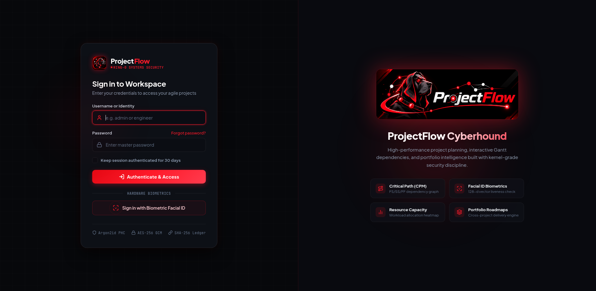
</p>

#### 🔬 In-Page Biometric Scanner Modal Overlay
Direct in-page WebRTC optical sensor scanner modal allowing one-click biometric verification without navigating away.
<p align="center">
  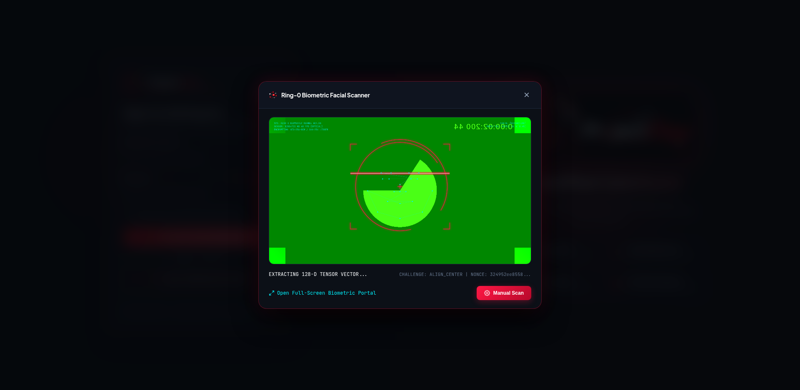
</p>

#### ⚡ Ring-0 Cyberhound Neural Biometric Gate
60 FPS hardware facial telemetry with 68-point neural landmark constellation overlay, scanning laser bar, and challenge-response liveness detection.
<p align="center">
  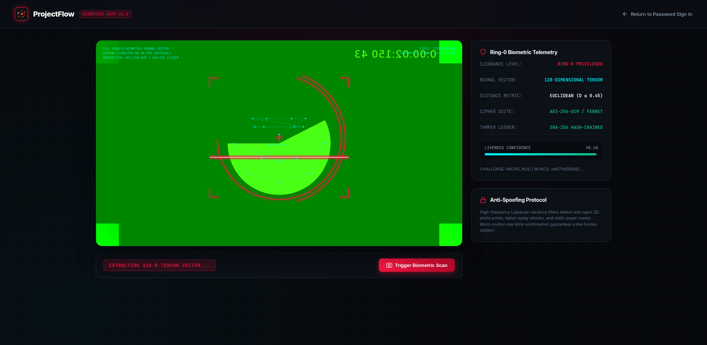
</p>

#### 📝 Account Registration Portal
New engineer onboarding portal with real-time password strength validation, department selection, and cryptographic email encryption.
<p align="center">
  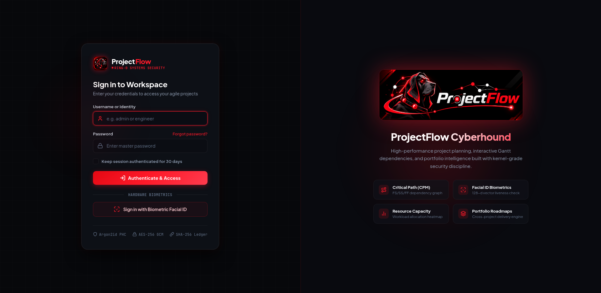
</p>

#### 🔑 Self-Service Password Recovery
Enumeration-resistant password reset dispatch workflow with time-locked, single-use cryptographic tokens.
<p align="center">
  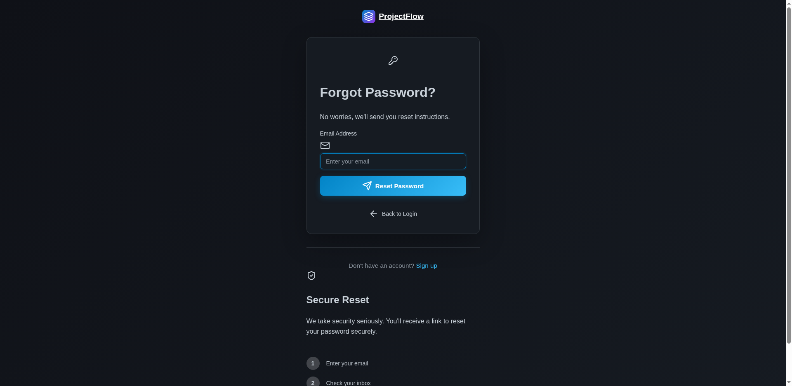
</p>

#### 🎯 Optical Biometric Enrollment & Setup Guide
Interactive calibration guide for enrolling primary optical sensors, setting confidence thresholds, and testing anti-spoofing detection.
<p align="center">
  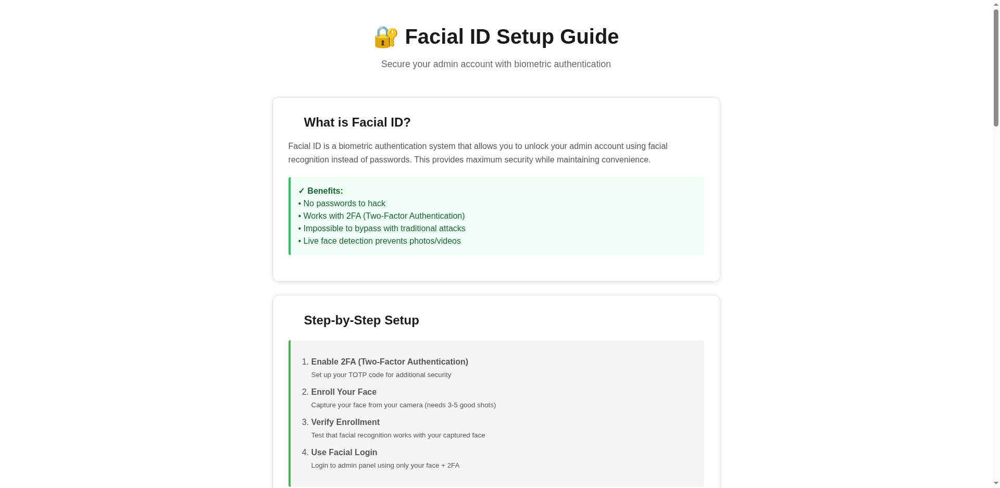
</p>

</details>

---

<details>
<summary><b>▶ 📊 2. Engineering & Delivery Workspace Nodes (Click to Expand)</b></summary>
<br>

#### 🏠 Unified Engineering Delivery Command Hub
Active sprint velocity telemetry, burndown progress, cross-project workload distribution, and real-time event streams.
<p align="center">
  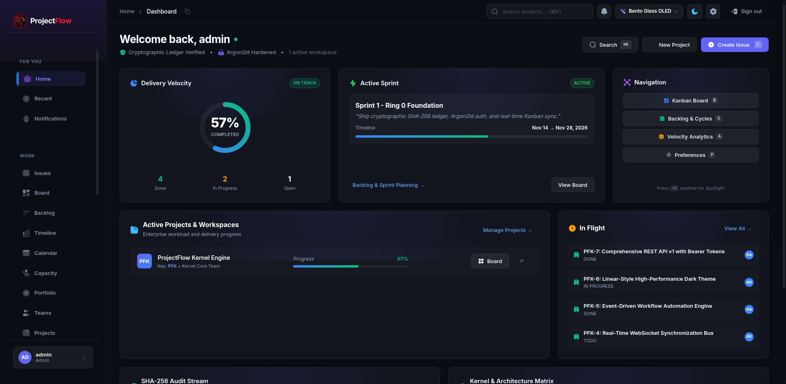
</p>

#### 📋 Agile Kanban Board
Interactive drag-and-drop workflow board with sub-20ms transitions, swimlanes, custom statuses, card tags, and instant filter toggling.
<p align="center">
  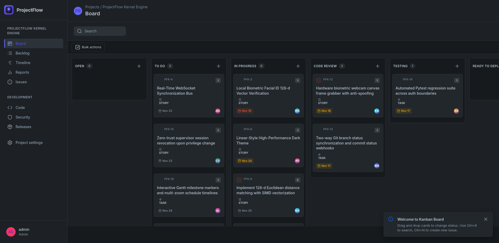
</p>

#### 🗓️ Interactive Roadmap & Gantt Engine
Drag-and-drop task scheduling across Day, Week, Month, and Quarter views with real-time SVG dependency connectors and Critical Path Method (CPM) calculation.
<p align="center">
  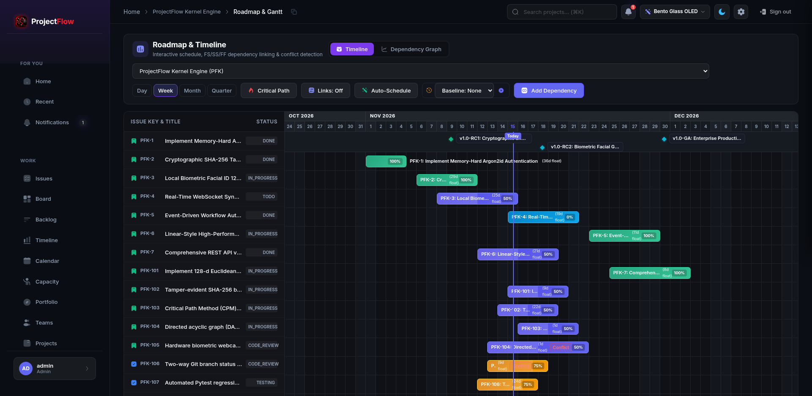
</p>

#### 🕸️ Directed Topological Dependency Graph
Graph visualizer linking issues across projects with cycle prevention, direction indicators, and topological conflict detection.
<p align="center">
  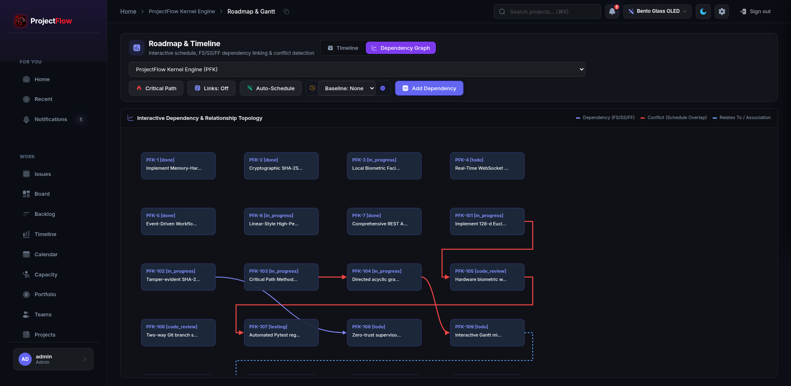
</p>

#### 👥 Resource Capacity & Utilization Planner
Contributor workload normalization, weekly allocation heatmaps, and automatic over-capacity warning indicators.
<p align="center">
  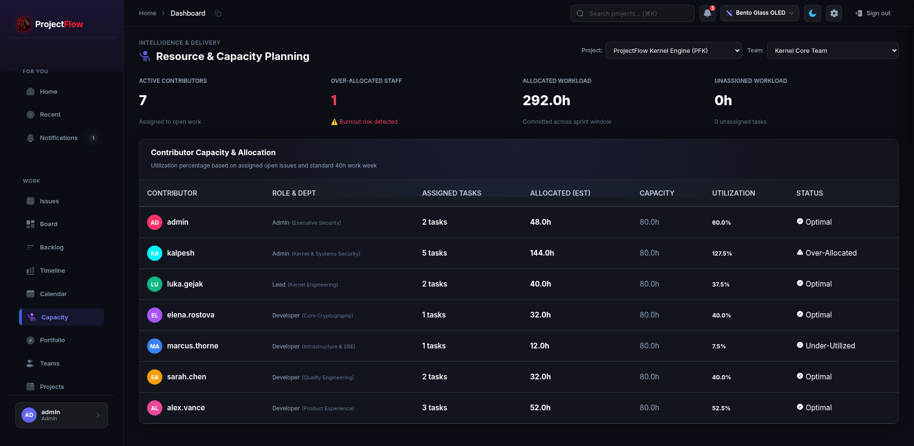
</p>

#### 🎯 Strategic Portfolio Roadmaps
Cross-project strategic initiative planning, delivery progress rollups, and multi-team health tracking.
<p align="center">
  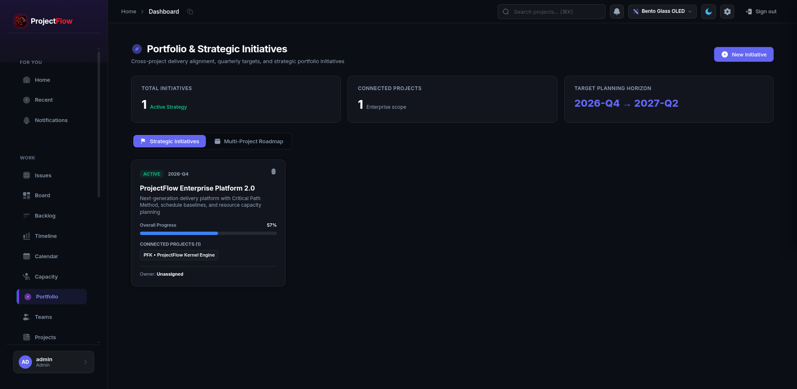
</p>

#### 📦 Sprint Grooming & Backlog Prioritization
Issue ranking, velocity point estimation, and drag-and-drop backlog prioritization.
<p align="center">
  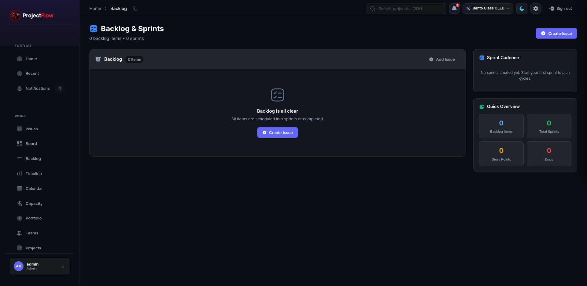
</p>

#### 🔍 Issue Navigator & Multi-Filter Omnibox
Advanced issue query engine with multi-parameter filtering by status, priority, assignee, tags, and milestone associations.
<p align="center">
  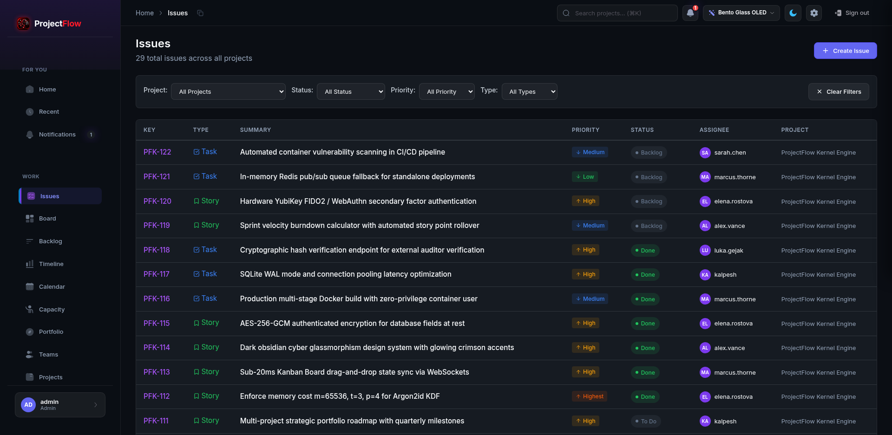
</p>

#### 📈 Velocity Analytics & Cumulative Flow
Real-time sprint velocity charts, cumulative flow diagrams, and historical burndown metrics.
<p align="center">
  
</p>

#### 📅 Schedule Planning & Milestones Calendar
Calendar-based milestone schedule, release dates, and scheduled issue delivery timelines.
<p align="center">
  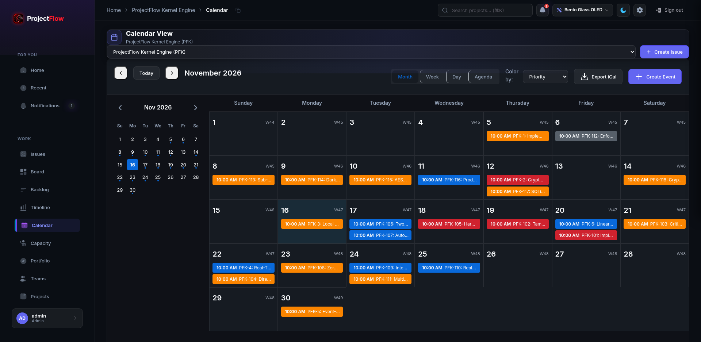
</p>

#### 🎫 ITIL Service Desk & Support Ticket Hub
Customer and internal service request management with SLA tracking, priority queues, and customer communication threads.
<p align="center">
  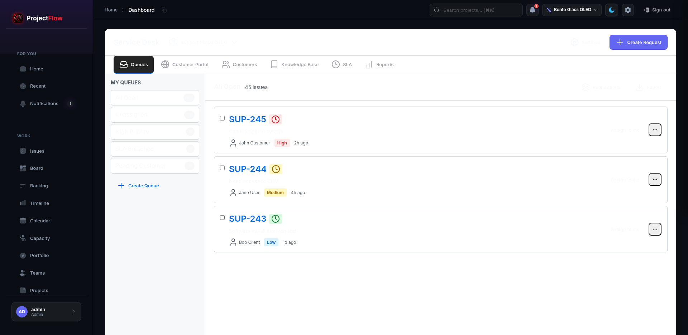
</p>

#### ⚡ Workflow Automation Engine
Visual rules engine automating issue assignments, status transitions, notifications, and webhooks upon state changes.
<p align="center">
  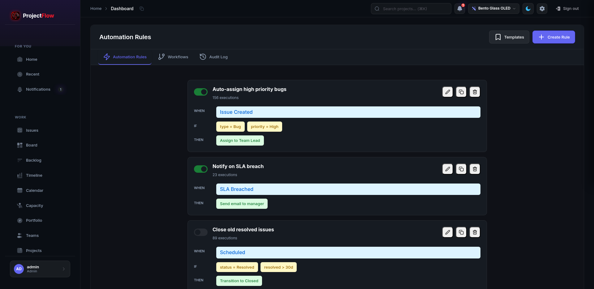
</p>

</details>

---

<details>
<summary><b>▶ 📁 3. Project Lifecycle & Code Governance Nodes (Click to Expand)</b></summary>
<br>

#### 🏢 Project Overview & Executive Summary Hub
Centralized project homepage with health metrics, milestone status, team assignments, and delivery summaries.
<p align="center">
  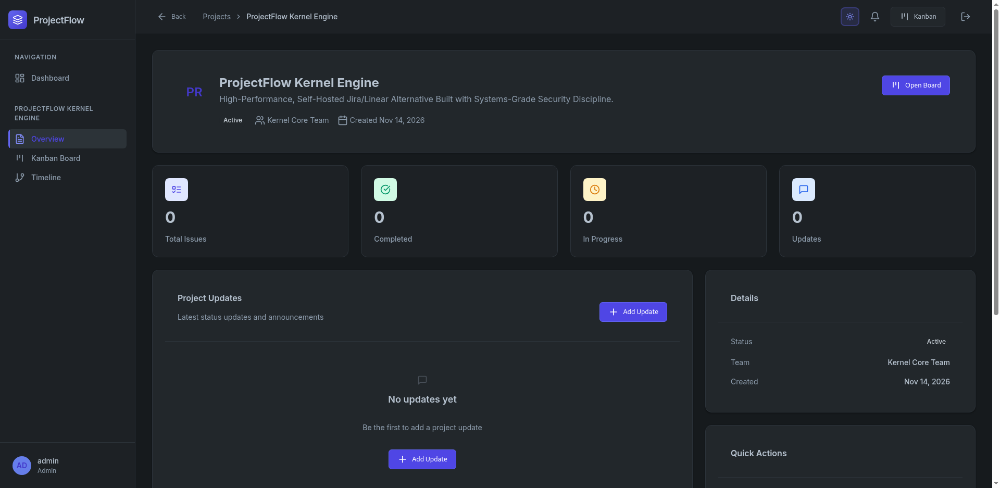
</p>

#### 🏃 Sprint Cycles & Lifecycle Management
Active, planned, and completed sprint orchestration with velocity forecasting and scope creep monitoring.
<p align="center">
  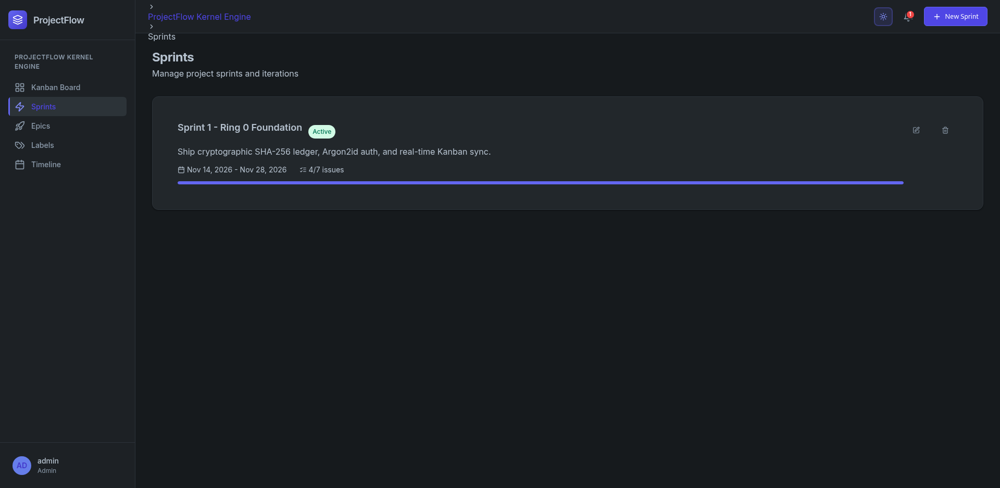
</p>

#### 🏆 Epic Roadmaps & Milestone Tracking
High-level epic management grouping related user stories into strategic delivery increments.
<p align="center">
  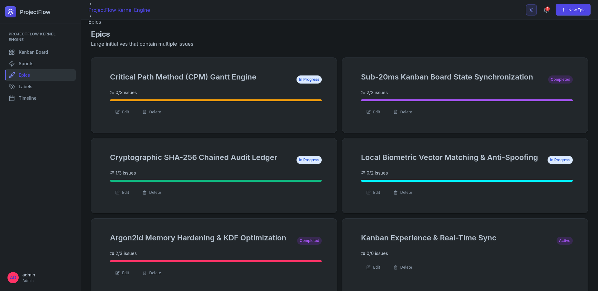
</p>

#### 📑 Project Issue Catalog & Work Items
Comprehensive catalog of work items, bugs, tasks, and stories scoped to the active project.
<p align="center">
  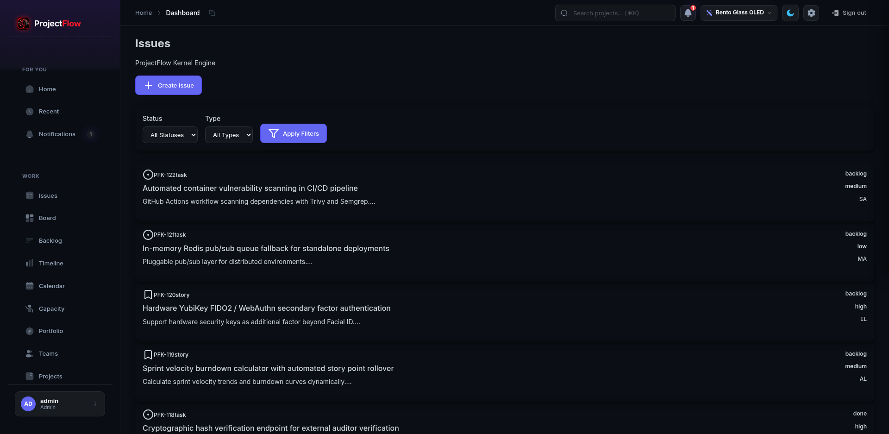
</p>

#### 📉 Sprint Velocity & Burndown Charts
Real-time burndown analytics comparing ideal vs. actual sprint trajectory.
<p align="center">
  
</p>

#### 🛡️ Project Security Governance & Access Auditing
Project-level security controls, role assignments, sensitive field encryption audit, and access history.
<p align="center">
  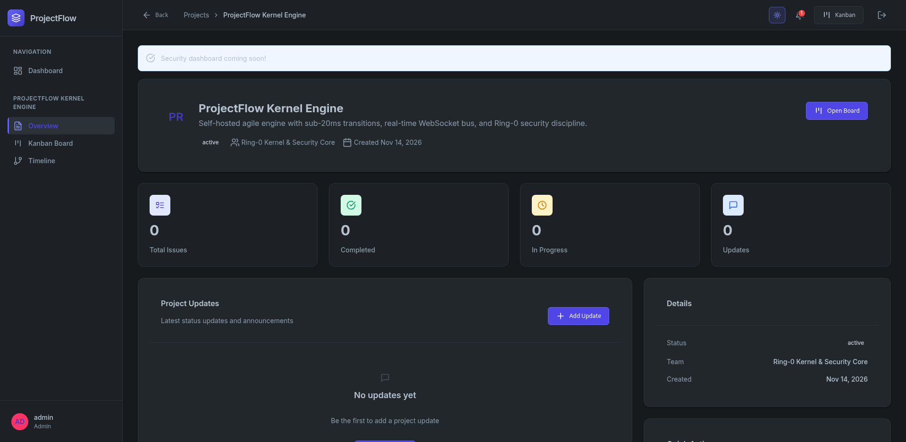
</p>

#### 🔗 Git & VCS Code Integrations
GitHub, GitLab, and Gitea webhook synchronization linking commits, pull requests, and branch builds directly to issues.
<p align="center">
  
</p>

#### 🚀 CI/CD Deployments & Release Pipelines
Deployment tracking across development, staging, and production environments with commit traceability.
<p align="center">
  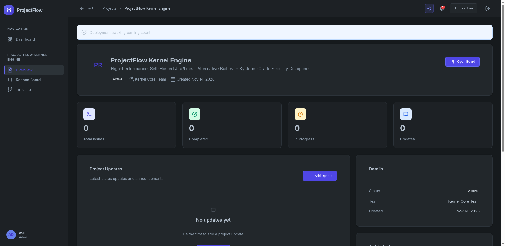
</p>

#### 🏁 Release Management & Artifact Milestones
SemVer release tagging, changelog generation, and milestone delivery status.
<p align="center">
  
</p>

#### 🏷️ Taxonomy, Labels & Categorization Tags
Customizable project taxonomy tags, color palettes, and component categorization.
<p align="center">
  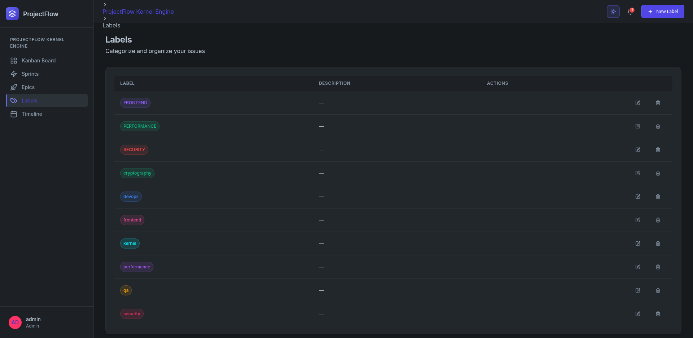
</p>

#### 🔄 State Machine Workflow Diagrams
Visual representation of permitted issue states and transition constraints.
<p align="center">
  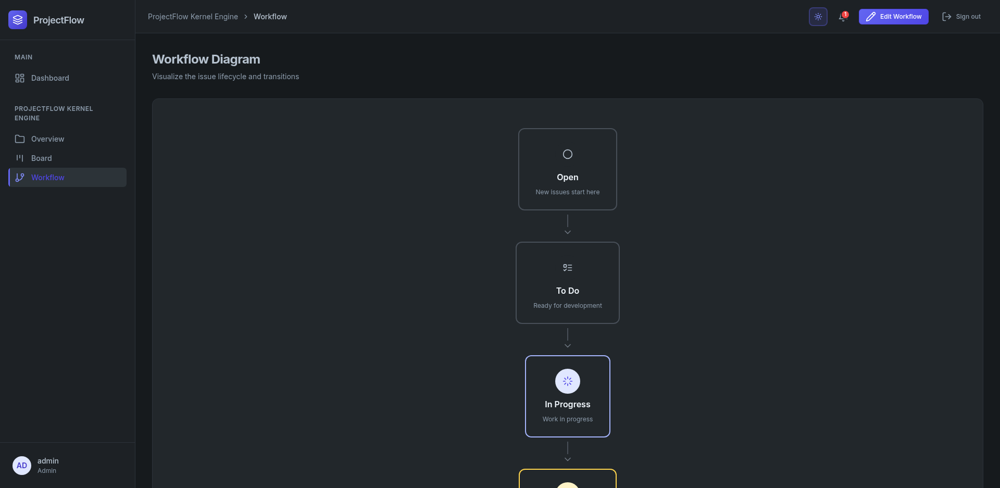
</p>

#### ⚙️ Project Settings & Configurations
Project keys, lead designations, default assignees, and integration secrets.
<p align="center">
  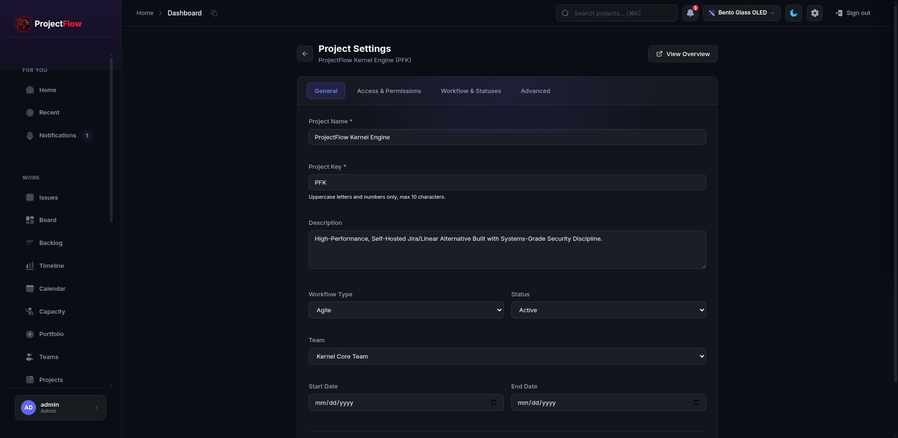
</p>

</details>

---

<details>
<summary><b>▶ ⚙️ 4. Enterprise Administration & Cryptographic Governance Nodes (Click to Expand)</b></summary>
<br>

#### 🎛️ Admin System Overview & Command Plane
Comprehensive administrative telemetry monitoring system health, active sessions, database connections, and worker threads.
<p align="center">
  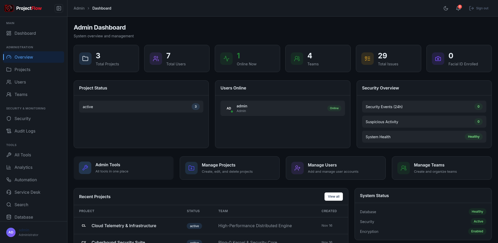
</p>

#### ⛓️ Tamper-Evident SHA-256 Blockchain Audit Ledger
Append-only cryptographic ledger tracking every administrative action with sequential block hash linking.
<p align="center">
  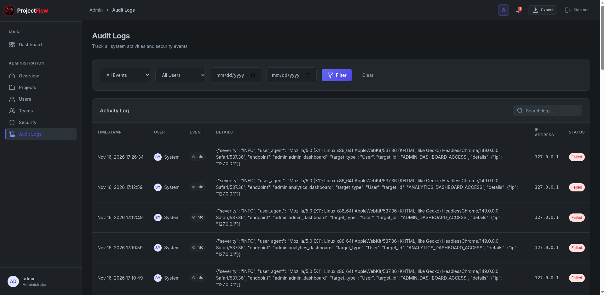
</p>

#### 🛡️ Security Policies & Governance Center
Enterprise security policies, session timeout parameters, brute-force lockout thresholds, and cipher preferences.
<p align="center">
  
</p>

#### 👥 User & Privilege Administration (RBAC)
Granular user privilege administration, role assignment, account unlocking, and active session termination.
<p align="center">
  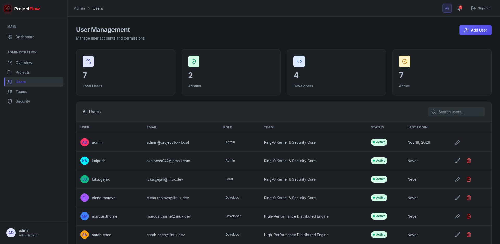
</p>

#### 🏢 Team Allocations & Permissions
Team modeling, member associations, and cross-project permissions.
<p align="center">
  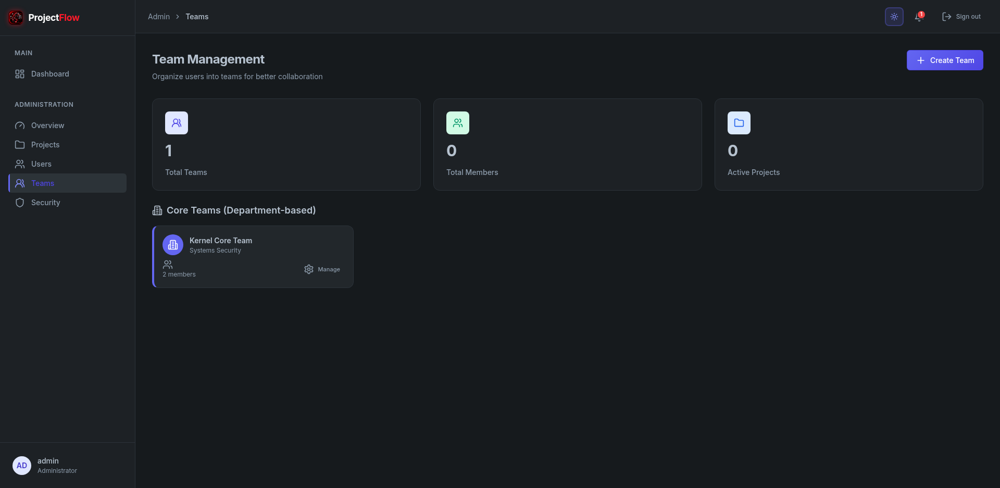
</p>

#### 🗄️ Database Health, Indexing & Storage Engine
Live database status, connection pools, index performance, and disk usage telemetry.
<p align="center">
  
</p>

#### 💾 Backup, Point-in-Time Restore & Snapshots
Automated database snapshot creation, export, and point-in-time disaster recovery.
<p align="center">
  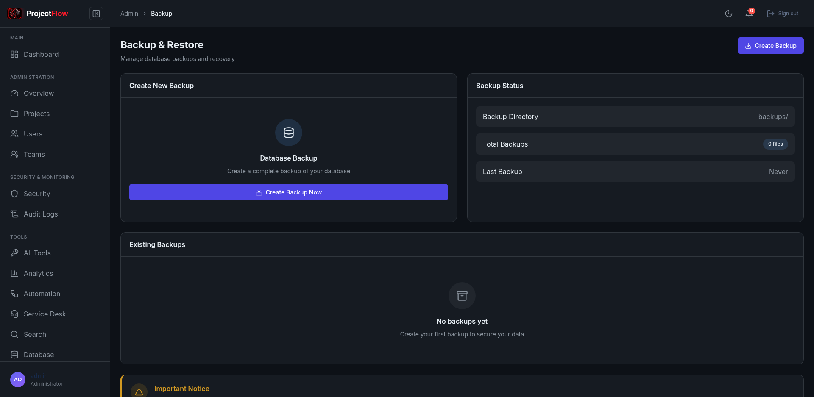
</p>

#### 🤖 Enterprise Automation Rules & Triggers
Global event-driven automation rules managing system alerts, escalations, and cross-project sync.
<p align="center">
  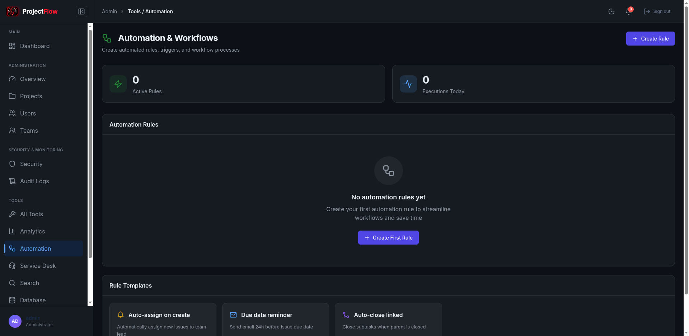
</p>

#### 🧬 Facial ID Hardware & Biometric Vault Settings
Vault configurations for facial recognition confidence thresholds, anti-spoofing parameters, and vector revocations.
<p align="center">
  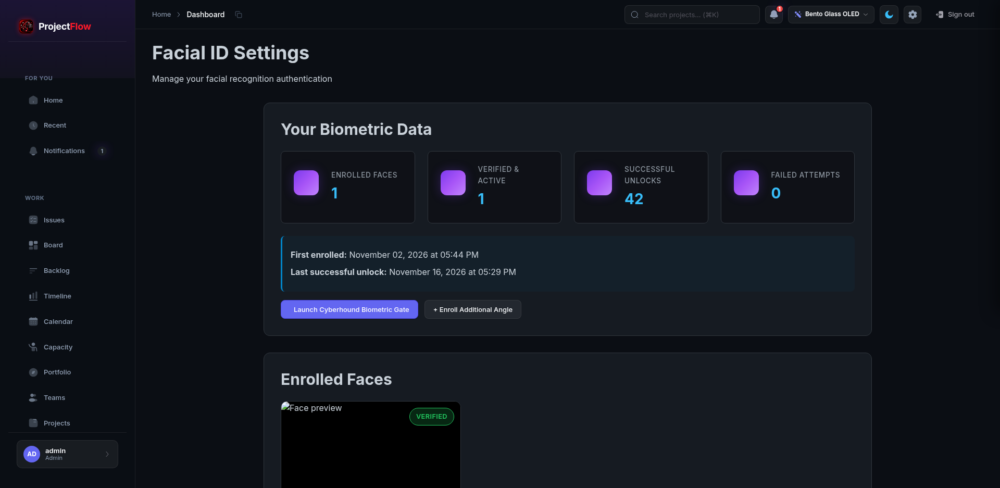
</p>

#### 🔌 Third-Party Webhooks & Integrations
Slack, Microsoft Teams, Jira sync, and custom webhook endpoint configurations.
<p align="center">
  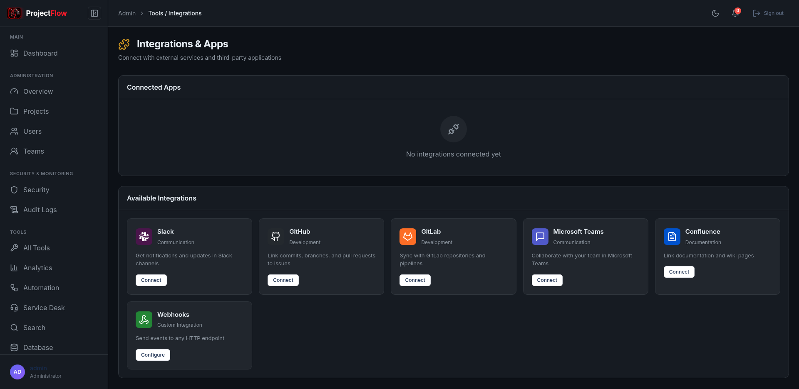
</p>

#### 📆 Enterprise Change Management Calendar
Scheduled system maintenance windows, freeze periods, and deployment change approvals.
<p align="center">
  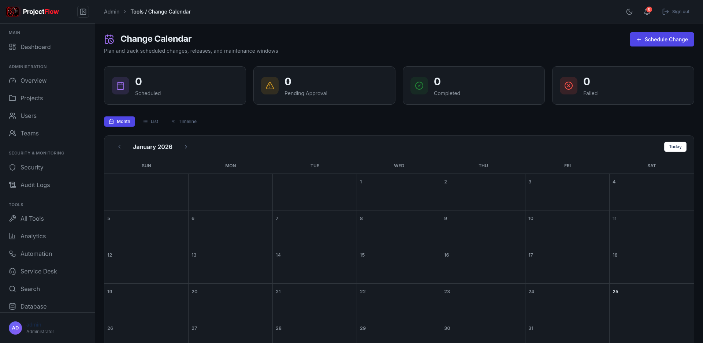
</p>

#### 🔧 Diagnostic & Maintenance Utilities
Cache invalidation, orphan record cleanup, and diagnostic ping utilities.
<p align="center">
  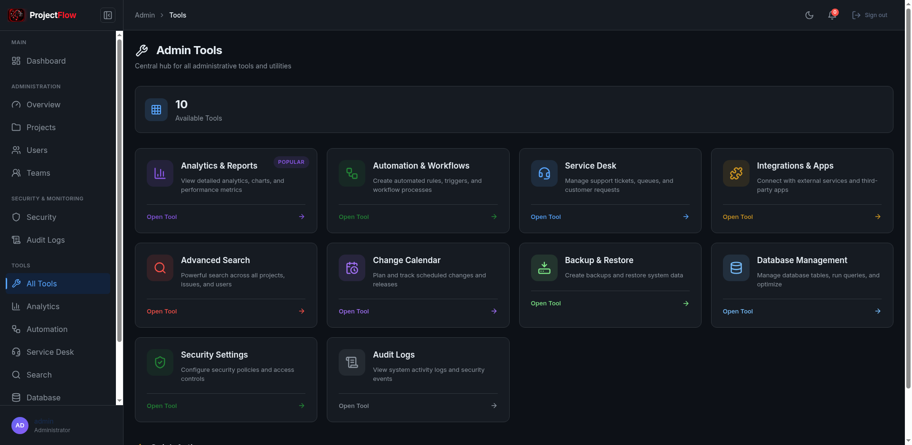
</p>

#### 🔎 Global Index Search Omnibox
Full-text index search administration across issues, comments, projects, and users.
<p align="center">
  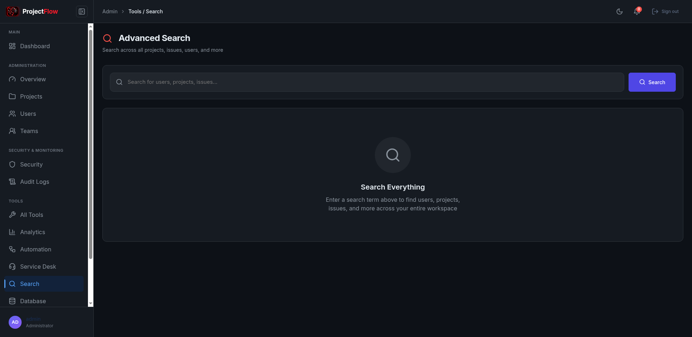
</p>

#### 👥 Organization Team Directory
Visual directory of teams, leadership contacts, and member assignments.
<p align="center">
  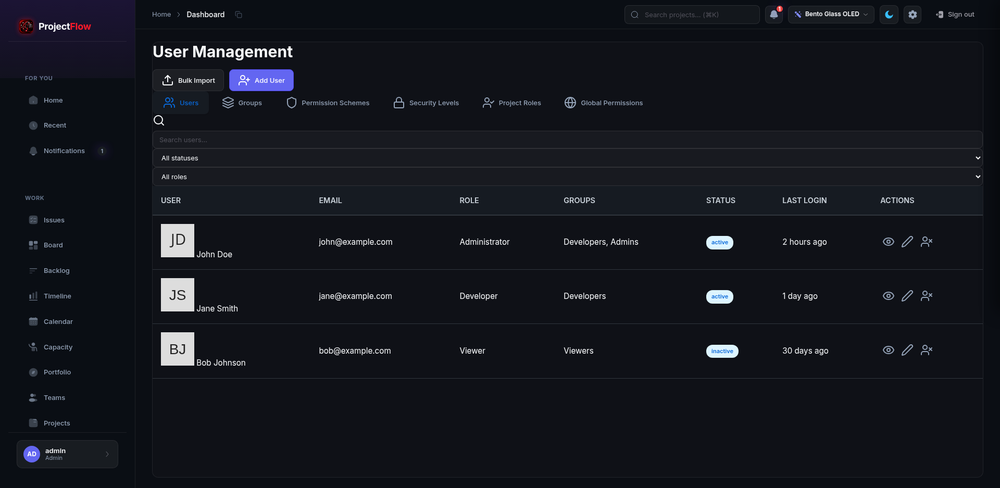
</p>

#### ⚙️ User Profile & Account Preferences
Personal profile settings, avatar customization, dark/light theme toggle, and personal notifications.
<p align="center">
  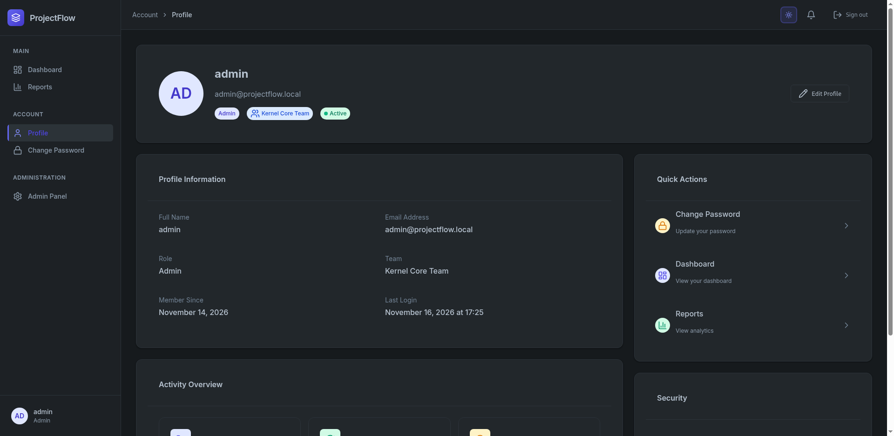
</p>

</details>

---

## 📡 RESTful API & Automation Engine

ProjectFlow includes an enterprise-grade RESTful API authenticated via cryptographically signed Bearer tokens:

```bash
# 1. Obtain Bearer Token
curl -X POST http://localhost:5000/api/v1/auth/token \
  -H "Content-Type: application/json" \
  -d '{"username": "admin", "password": "AdminPassword123!"}'

# 2. Verify Cryptographic SHA-256 Blockchain Audit Ledger Integrity (Ring 0)
curl -X GET http://localhost:5000/api/v1/audit/ledger/verify \
  -H "Authorization: Bearer <TOKEN>"

# 3. Create Project & Issues
curl -X POST http://localhost:5000/api/v1/projects \
  -H "Authorization: Bearer <TOKEN>" \
  -H "Content-Type: application/json" \
  -d '{"name": "Kernel Hypervisor", "key": "KHM", "workflow_type": "agile"}'

# 4. Fetch Sprint Burndown & Velocity Analytics
curl -X GET http://localhost:5000/api/v1/analytics/burndown/1 \
  -H "Authorization: Bearer <TOKEN>"
```

---

## 🤝 Contributing

Contributions are welcome! Please review [CONTRIBUTING.md](CONTRIBUTING.md) for branch naming conventions, pre-commit standards, and pull request guidelines.

1. Fork the Project
2. Create your Feature Branch (`git checkout -b feature/amazing-feature`)
3. Commit your Changes (`git commit -m 'Add amazing feature'`)
4. Push to the Branch (`git push origin feature/amazing-feature`)
5. Open a Pull Request

---

## 📄 License

This project is licensed under the MIT License - see the [LICENSE](LICENSE) file for details.

Developed with systems precision by [Kalpesh Solanki (@xploitoverload)](https://github.com/xploitoverload).
