# ProjectFlow

[](https://github.com/xploitoverload/ProjectFlow/actions)
[](https://opensource.org/licenses/MIT)
[](https://www.python.org/downloads/)
[](https://github.com/P-H-C/phc-winner-argon2)
[](#-tamper-evident-audit-ledger)
[](CONTRIBUTING.md)

> **High-Performance, Self-Hosted Jira/Linear Alternative Built with Systems-Grade Security Discipline.**  
> Featuring biometric Facial ID authentication, memory-hard Argon2id hashing, and a cryptographic tamper-evident audit ledger.

<p align="center">
  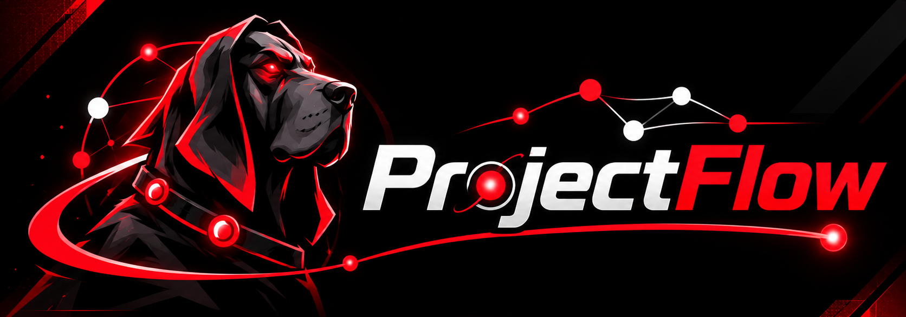
</p>

---

## ⚡ Why ProjectFlow?

Most project trackers are either heavy enterprise beasts consuming gigabytes of RAM or fragile web apps with superficial security. **ProjectFlow** is engineered with kernel-grade discipline:

- 🚀 **Blazingly Fast**: Lightweight, responsive Kanban boards with sub-20ms queries and instant workflow transitions.
- 🛡️ **Ring 0 Security Philosophy**:
  - **Biometric Facial Recognition**: Hardware-accelerated local facial embeddings (128-d vectors) with anti-spoofing liveness detection.
  - **Argon2id Password Hashing**: Memory-hard password protection adhering to the Password Hashing Competition (PHC) & OWASP standards.
  - **Tamper-Evident SHA-256 Audit Ledger**: Every administrative and security action is cryptographically chained ($hash_n = \text{SHA256}(hash_{n-1} + \text{event})$), detecting database tampering immediately.
  - **Strict Least-Privilege RBAC**: Strong server-side session protection and zero client-forged authorization bypasses.
- 📊 **Real-World Agile Workflows**: Native support for Epics, Sprints, Kanban Board drag-and-drop, Issue dependencies, and Encrypted Comments.
- 🐳 **1-Command Docker Deployment**: Ready to run out of the box on Linux, macOS, and container clusters.

---

## 🚀 Quickstart

### Option 1: Docker (Recommended)

```bash
# Clone the repository
git clone https://github.com/xploitoverload/ProjectFlow.git
cd ProjectFlow

# Run with docker-compose
docker compose up -d
```
Access the application at `http://localhost:5000`.

### Option 2: Local Setup

```bash
# 1. Clone repository
git clone https://github.com/xploitoverload/ProjectFlow.git
cd ProjectFlow

# 2. Create virtual environment
python3 -m venv .venv
source .venv/bin/activate

# 3. Install dependencies
pip install -r requirements.txt

# 4. Run application
python run.py
```

---

## 🛡️ Systems-Grade Security & Authentication Nodes

### 1. Cyberhound Authentication & Biometric Scanner Gate
Redesigned authentication portal featuring the ProjectFlow Cyberhound identity, glowing neon crimson telemetry, and hardware biometric facial ID integration.

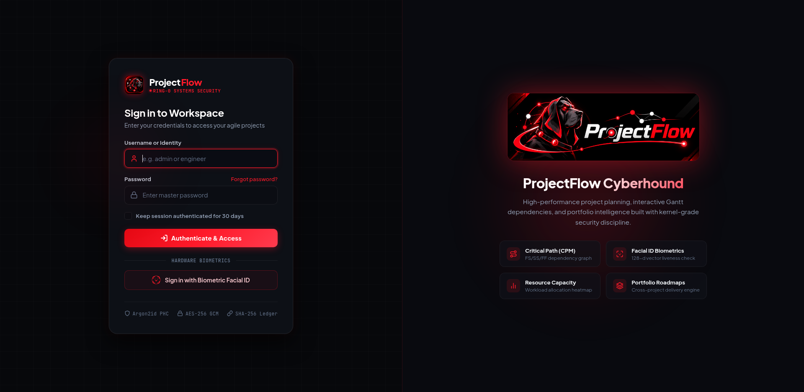

### 2. Ring-0 Cyberhound Neural Biometric Gate
On-device hardware optical sensor tracking neural facial landmarks at 60 FPS. Features dynamic challenge-response anti-spoofing (eye-aspect-ratio blink analysis, micro-motion entropy, and Laplacian texture frequency analysis) combined with 128-dimensional Euclidean tensor matching ($D \le 0.45$). All biometric embeddings are encrypted with AES-256 before disk storage and linked to the tamper-evident SHA-256 audit ledger.


### 3. Cryptographic Tamper-Evident SHA-256 Audit Ledger
All security events, permission escalations, and logins are committed to an append-only cryptographic ledger. Each block links back to the preceding block:

$$\text{record\_hash}_i = \text{SHA256}(\text{prev\_hash}_{i-1} \,\|\, \text{user\_id} \,\|\, \text{action} \,\|\, \text{payload} \,\|\, \text{timestamp})$$

Any direct database tampering or row deletion permanently invalidates the cryptographic chain and triggers an immediate alert during integrity verification:

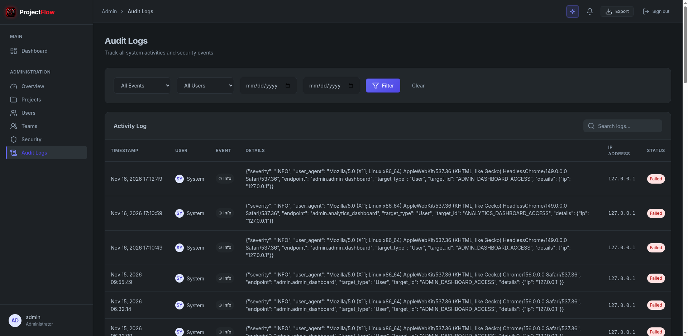

### 4. Argon2id Password Hashing & Security Policies
Password hashes are computed using **Argon2id** (OWASP recommended memory-hard hashing), resisting GPU/ASIC brute-force attacks:
```python
user.set_password("SecurePassword123!")
# Stores: $argon2id$v=19$m=65536,t=3,p=4$...
```

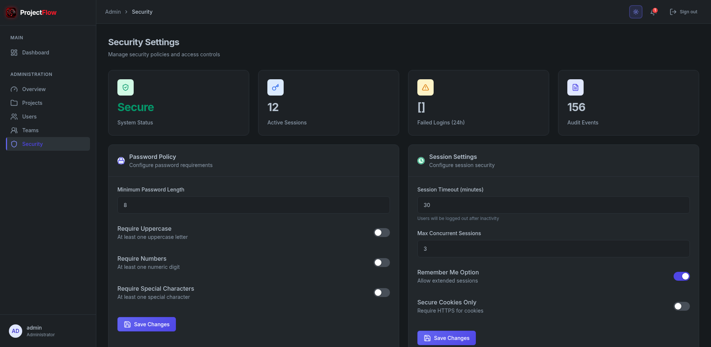

---

## 📊 User & Engineering Workspaces

### 🏠 Dashboard & Active Sprint Command Hub
Unified delivery overview displaying active sprint velocity, burndown progress, cross-project workload, and real-time event streams.

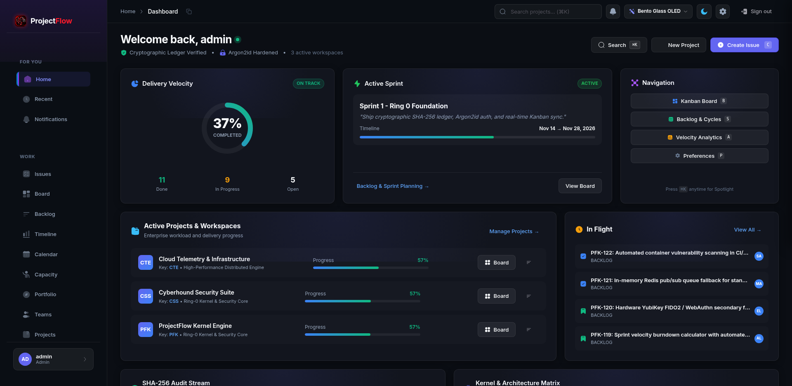

### 📋 Agile Kanban Board
Interactive drag-and-drop workflow board with sub-20ms transitions, swimlanes, custom statuses, card tags, and instant filter toggling.

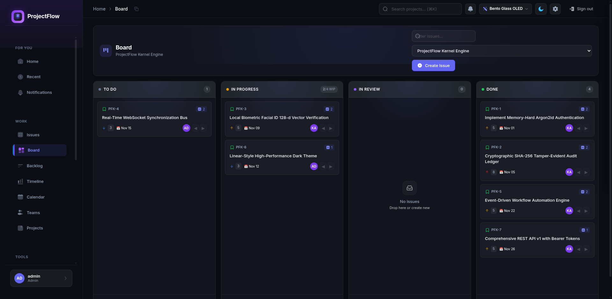

### 🗓️ Interactive Roadmap & Gantt Engine
Drag-and-drop task scheduling across Day, Week, Month, and Quarter views with real-time SVG dependency connectors, milestone markers, and automated Critical Path Method (CPM) calculation.

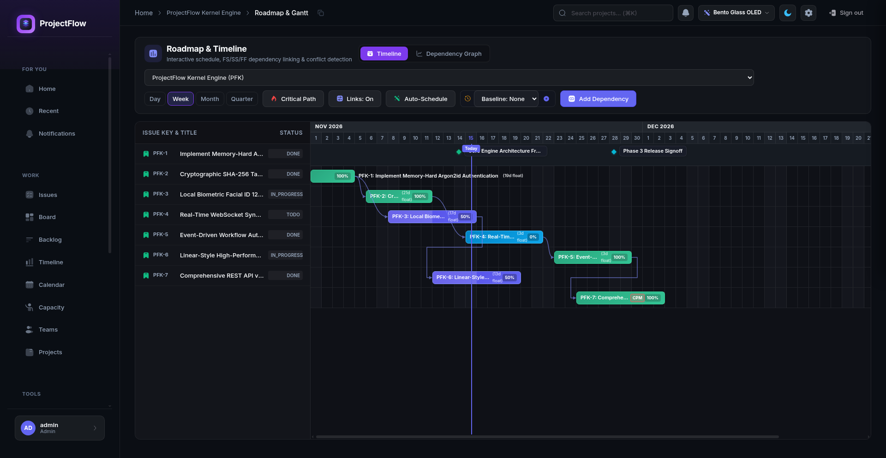

### 🕸️ Interactive Dependency Graph
Directed topological dependency graph visualizer linking issues across projects with cycle prevention, direction indicators, and conflict detection.

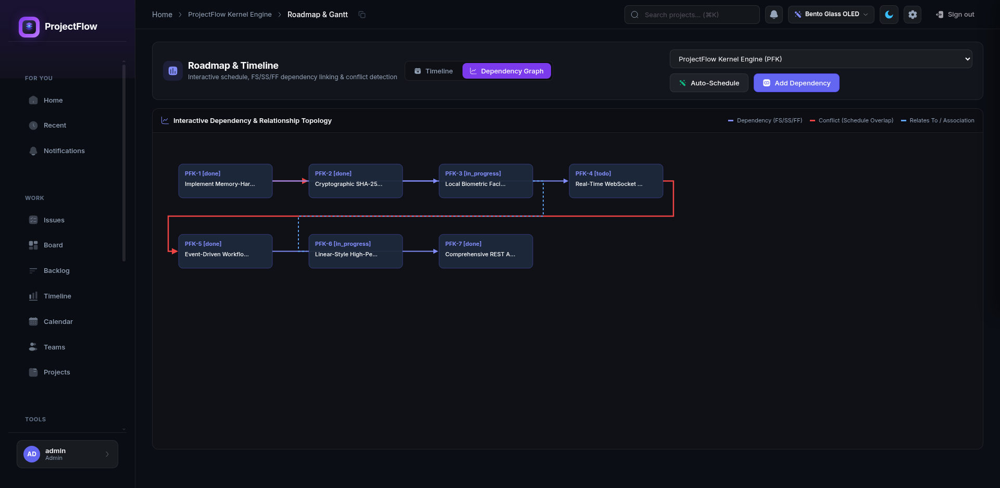

### 👥 Resource Capacity & Utilization Planner
Contributor workload normalization, weekly allocation heatmaps, and automatic over-capacity warning indicators.


### 🎯 Strategic Portfolio Roadmaps
Cross-project strategic initiative planning, delivery progress rollups, and multi-team health tracking.


### 📦 Agile Backlog & Sprint Management
Sprint grooming, issue ranking, velocity point estimation, and drag-and-drop backlog prioritization.

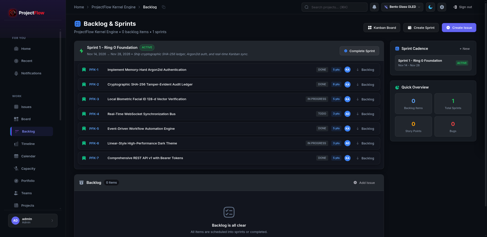

### 🔍 Issue Navigator & Filters
Advanced issue search with multi-parameter filtering by status, priority, assignee, tags, and milestone associations.


### 📈 Reports & Agile Velocity Analytics
Real-time sprint velocity charts, cumulative flow diagrams, and burndown analytics.

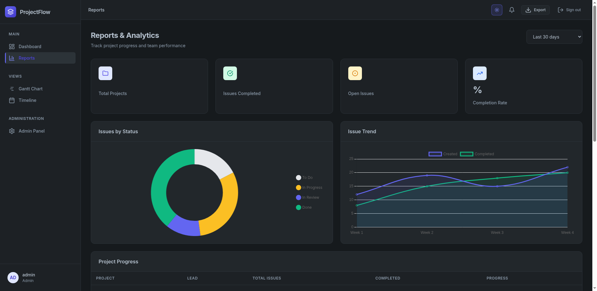

### 📅 Calendar Planning View
Calendar-based milestone schedule, release dates, and scheduled issue delivery timelines.

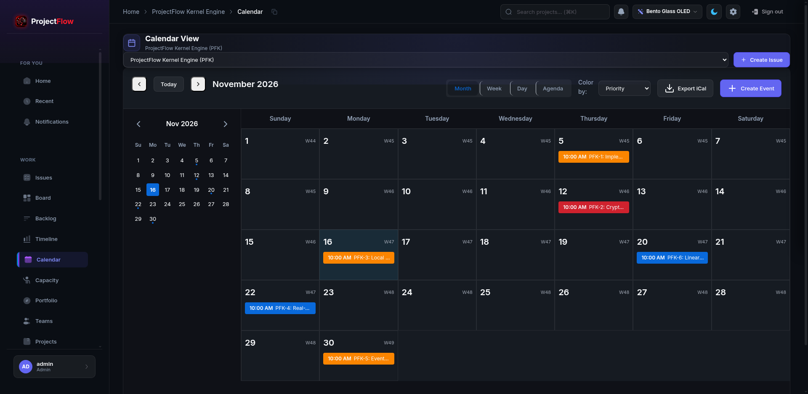

---

## ⚙️ Administration & Governance Nodes

### 🎛️ Admin System Overview
Comprehensive administrative telemetry monitoring system health, active user sessions, database metrics, and project quotas.


### 👥 User & Privilege Administration (RBAC)
Role-Based Access Control (RBAC) supporting granular permissions, account unlock, session termination, and biometric enrollment.


### 🏢 Team Management & Multi-Project Allocation
Team structure modeling, member assignments, and cross-project permissions.

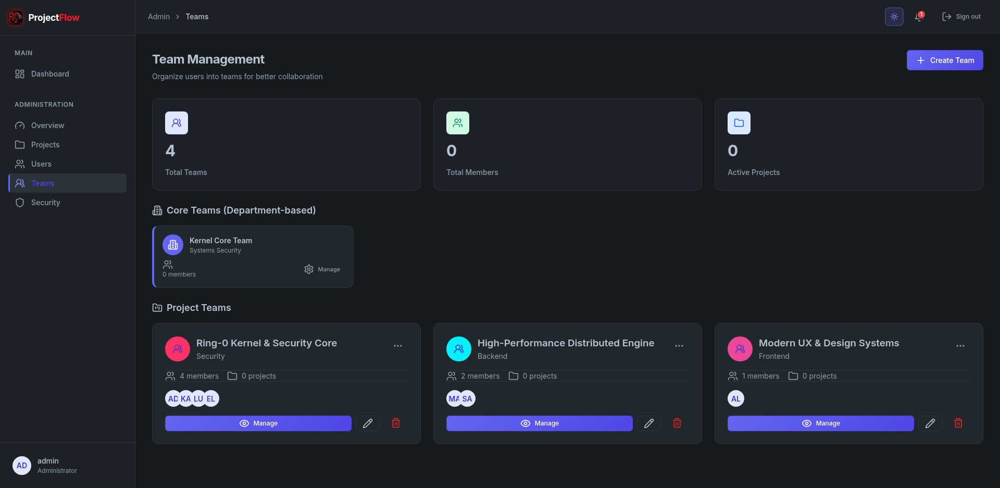

### 🗄️ Database Optimizations & Storage Engine
Live database status, connection metrics, index optimization, and snapshot maintenance.

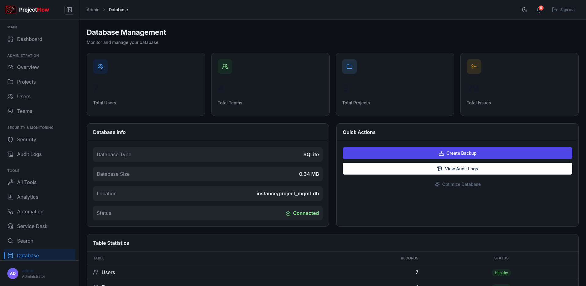

---

## 📡 RESTful API & Automation Engine

ProjectFlow includes an enterprise-grade RESTful API authenticated via cryptographically signed Bearer tokens:

```bash
# 1. Obtain Bearer Token
curl -X POST http://localhost:5000/api/v1/auth/token \
  -H "Content-Type: application/json" \
  -d '{"username": "admin", "password": "AdminPassword123!"}'

# 2. Verify Cryptographic SHA-256 Audit Ledger Integrity (Ring 0)
curl -X GET http://localhost:5000/api/v1/audit/ledger/verify \
  -H "Authorization: Bearer <TOKEN>"

# 3. Create Project & Issues
curl -X POST http://localhost:5000/api/v1/projects \
  -H "Authorization: Bearer <TOKEN>" \
  -H "Content-Type: application/json" \
  -d '{"name": "Kernel Hypervisor", "key": "KHM", "workflow_type": "agile"}'

# 4. Fetch Sprint Burndown & Velocity Analytics
curl -X GET http://localhost:5000/api/v1/analytics/burndown/1 \
  -H "Authorization: Bearer <TOKEN>"
```

---

## 🤝 Contributing

Contributions are welcome! Please review [CONTRIBUTING.md](CONTRIBUTING.md) for branch naming conventions, pre-commit standards, and pull request guidelines.

1. Fork the Project
2. Create your Feature Branch (`git checkout -b feature/amazing-feature`)
3. Commit your Changes (`git commit -m 'Add amazing feature'`)
4. Push to the Branch (`git push origin feature/amazing-feature`)
5. Open a Pull Request

---

## 📄 License

This project is licensed under the MIT License - see the [LICENSE](LICENSE) file for details.

Developed with systems precision by [Kalpesh Solanki (@xploitoverload)](https://github.com/xploitoverload).
