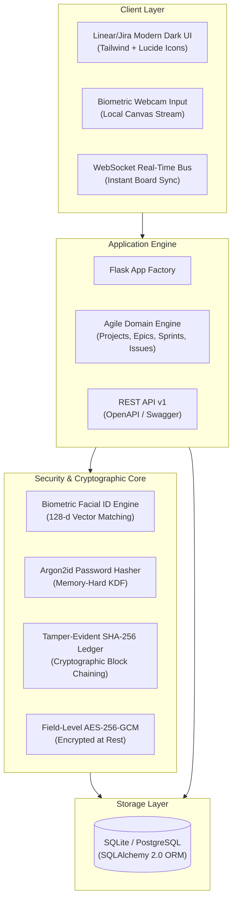

# ProjectFlow

[](https://github.com/xploitoverload/ProjectFlow/actions)
[](https://opensource.org/licenses/MIT)
[](https://www.python.org/downloads/)
[](https://github.com/P-H-C/phc-winner-argon2)
[](#-tamper-evident-audit-ledger)
[](CONTRIBUTING.md)

> **High-Performance, Self-Hosted Jira/Linear Alternative Built with Systems-Grade Security Discipline.**  
> Featuring biometric Facial ID authentication, memory-hard Argon2id hashing, and a cryptographic tamper-evident audit ledger.

---

## ⚡ Why ProjectFlow?

Most project trackers are either heavy enterprise beasts consuming gigabytes of RAM or fragile web apps with superficial security. **ProjectFlow** is engineered with kernel-grade discipline:

- 🚀 **Blazingly Fast**: Lightweight, responsive Kanban boards with sub-20ms queries and instant workflow transitions.
- 🛡️ **Ring 0 Security Philosophy**:
  - **Biometric Facial Recognition**: Hardware-accelerated local facial embeddings (128-d vectors) with anti-spoofing liveness detection.
  - **Argon2id Password Hashing**: Memory-hard password protection adhering to the Password Hashing Competition (PHC) & OWASP standards.
  - **Tamper-Evident SHA-256 Audit Ledger**: Every administrative and security action is cryptographically chained ($hash_n = \text{SHA256}(hash_{n-1} + \text{event})$), detecting database tampering immediately.
  - **Strict Least-Privilege RBAC**: Strong server-side session protection and zero client-forged authorization bypasses.
- 📊 **Real-World Agile Workflows**: Native support for Epics, Sprints, Kanban Board drag-and-drop, Issue dependencies, and Encrypted Comments.
- 🐳 **1-Command Docker Deployment**: Ready to run out of the box on Linux, macOS, and container clusters.

---

## 🏗️ Architecture



---

## 🚀 Quickstart

### Option 1: Docker (Recommended)

```bash
# Clone the repository
git clone https://github.com/xploitoverload/ProjectFlow.git
cd ProjectFlow

# Run with docker-compose
docker compose up -d
```
Access the application at `http://localhost:5000`.

### Option 2: Local Setup

```bash
# 1. Clone repository
git clone https://github.com/xploitoverload/ProjectFlow.git
cd ProjectFlow

# 2. Create virtual environment
python3 -m venv .venv
source .venv/bin/activate

# 3. Install dependencies
pip install -r requirements.txt

# 4. Run application
python run.py
```

---

## 🛡️ Systems-Grade Security Features

### 1. Cryptographic Tamper-Evident Audit Ledger
All security events, permission escalations, and logins are committed to an append-only cryptographic ledger. Each block links back to the preceding block:

$$\text{record\_hash}_i = \text{SHA256}(\text{prev\_hash}_{i-1} \,\|\, \text{user\_id} \,\|\, \text{action} \,\|\, \text{payload} \,\|\, \text{timestamp})$$

Any direct database tampering or row deletion permanently invalidates the cryptographic chain and triggers an alert during integrity verification:
```python
from app.services.audit_service import AuditService

# Verify complete ledger integrity across entire history
is_valid, broken_id, msg = AuditService.verify_ledger_integrity()
assert is_valid is True
```

### 2. Argon2id Password Hashing
Password hashes are computed using **Argon2id** (OWASP recommended memory-hard hashing), resisting GPU/ASIC brute-force attacks:
```python
user.set_password("SecurePassword123!")
# Stores: $argon2id$v=19$m=65536,t=3,p=4$...
```

### 3. Biometric Facial ID Authentication
* Local, on-device vector generation comparing 128-dimensional Euclidean distances.
* Facial encodings and preview frames are encrypted with AES-256 before disk storage.
* Multi-factor verification (Facial ID + TOTP 2FA via Google Authenticator or YubiKey).

---

## 🧪 Testing & Verification

ProjectFlow includes a comprehensive Pytest test suite covering REST APIs, automation workflows, cryptographic integrity, validation, and agile workflows:

```bash
# Run test suite
pytest tests/ -v

# Run with coverage report
pytest tests/ --cov=app --cov-report=term-missing
```

```
tests/test_api_v1.py .............                                      [ 18%]
tests/test_audit_ledger.py ....                                          [ 24%]
tests/test_auth.py .........                                             [ 37%]
tests/test_automation_engine.py .....                                    [ 44%]
tests/test_health.py .......                                             [ 55%]
tests/test_kanban_core.py ....                                           [ 60%]
tests/test_security.py ........                                          [ 72%]
tests/test_services.py .....                                             [ 79%]
tests/test_validators.py ..............                                  [100%]

======================= 69 passed, 0 failures =======================
```

---

## 📡 RESTful API & Automation Engine

ProjectFlow includes an enterprise-grade RESTful API authenticated via cryptographically signed Bearer tokens:

```bash
# 1. Obtain Bearer Token
curl -X POST http://localhost:5000/api/v1/auth/token \
  -H "Content-Type: application/json" \
  -d '{"username": "admin", "password": "AdminPassword123!"}'

# 2. Verify Cryptographic SHA-256 Audit Ledger Integrity (Ring 0)
curl -X GET http://localhost:5000/api/v1/audit/ledger/verify \
  -H "Authorization: Bearer <TOKEN>"

# 3. Create Project & Issues
curl -X POST http://localhost:5000/api/v1/projects \
  -H "Authorization: Bearer <TOKEN>" \
  -H "Content-Type: application/json" \
  -d '{"name": "Kernel Hypervisor", "key": "KHM", "workflow_type": "agile"}'

# 4. Fetch Sprint Burndown & Velocity Analytics
curl -X GET http://localhost:5000/api/v1/analytics/burndown/1 \
  -H "Authorization: Bearer <TOKEN>"
```

---

## 🤝 Contributing

Contributions are welcome! Please review [CONTRIBUTING.md](CONTRIBUTING.md) for branch naming conventions, pre-commit standards, and pull request guidelines.

1. Fork the Project
2. Create your Feature Branch (`git checkout -b feature/amazing-feature`)
3. Commit your Changes (`git commit -m 'Add amazing feature'`)
4. Push to the Branch (`git push origin feature/amazing-feature`)
5. Open a Pull Request

---

## 📄 License

This project is licensed under the MIT License - see the [LICENSE](LICENSE) file for details.

Developed with systems precision by [Kalpesh Solanki (@xploitoverload)](https://github.com/xploitoverload).
